# Social Network

A full-stack social network — posts, followers, groups, events and real-time chat — built with a
**Go API** and a **Next.js 16 web client**, containerized with Docker.

<p align="center">
  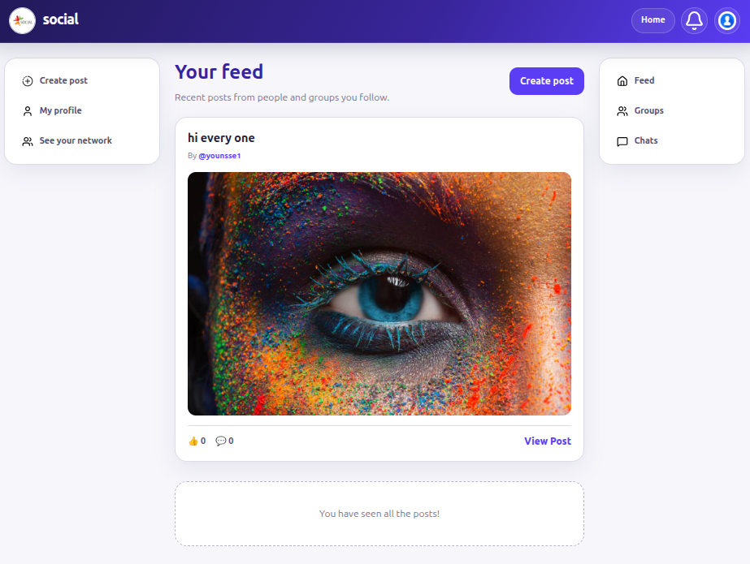
</p>

---

## Table of contents

- [Overview](#overview)
- [Screenshots](#screenshots)
- [Tech stack](#tech-stack)
- [Architecture](#architecture)
- [Features](#features)
- [Project structure](#project-structure)
- [Getting started](#getting-started)
- [Configuration](#configuration)
- [API reference](#api-reference)
- [Database](#database)
- [Roadmap / status](#roadmap--status)

---

## Overview

Social Network lets people sign up, share posts with images, follow each other, organize into
groups with events, chat in real time over WebSockets, and get notified about everything that
matters — all with per-post and per-profile privacy controls.

| | |
|---|---|
| **Backend** | Go 1.27, `net/http`, clean architecture (handlers → services → repositories → SQLite) |
| **Frontend** | Next.js 16 (App Router), React 19, Tailwind CSS 4, CSS modules |
| **Database** | SQLite via `mattn/go-sqlite3`, schema managed with `golang-migrate` |
| **Real time** | `gorilla/websocket` hub for private chat, group chat and live notifications |
| **Ports** | API `:8081`, Web `:3000` |

---

## Screenshots

| | |
|:---:|:---:|
| 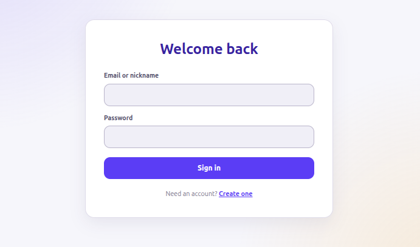<br/>**Sign in** | 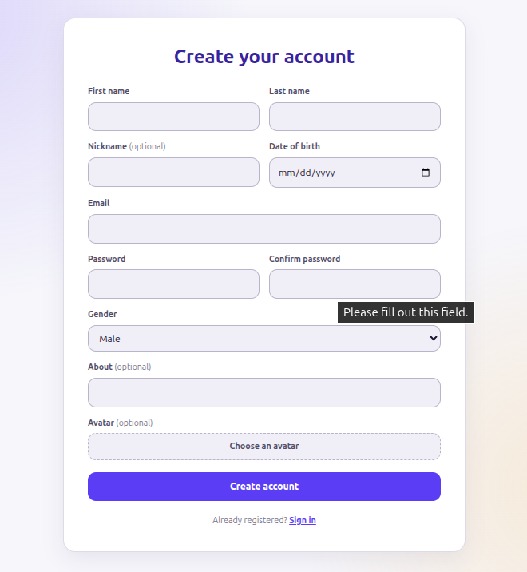<br/>**Sign up** |
| <br/>**Home feed** | 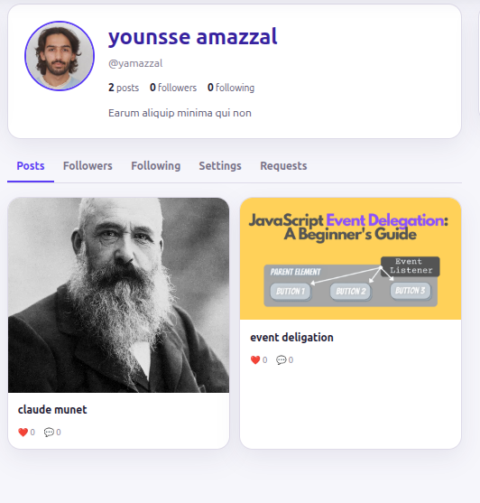<br/>**Profile** |
| 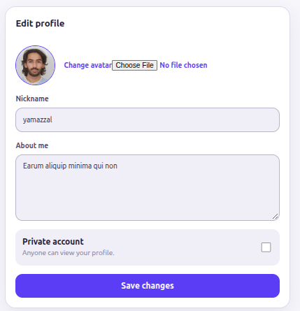<br/>**Edit profile & privacy** | 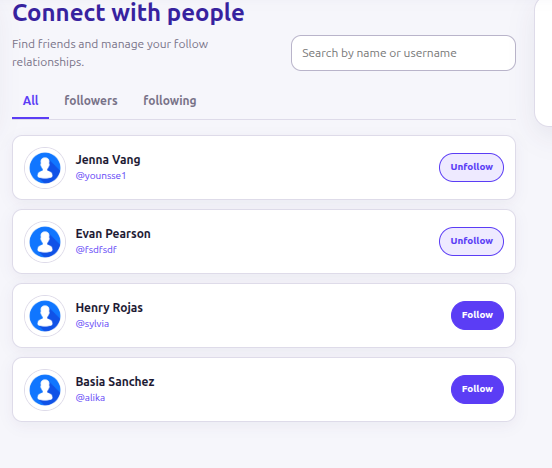<br/>**Connect with people** |
| 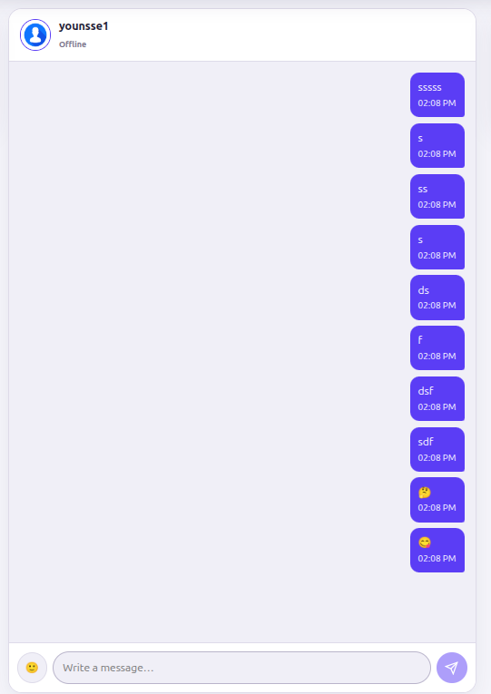<br/>**Private chat** | 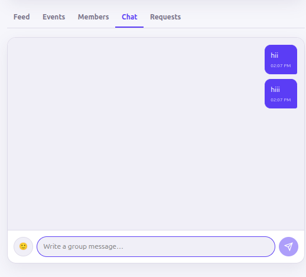<br/>**Group chat** |
| 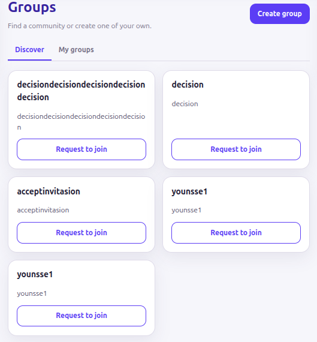<br/>**Discover groups** | 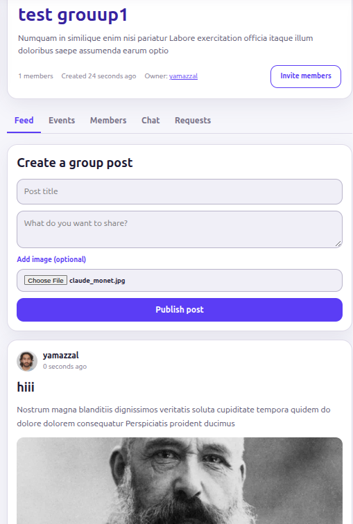<br/>**Group details** |
| 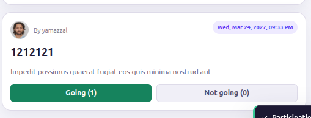<br/>**Group events & voting** | 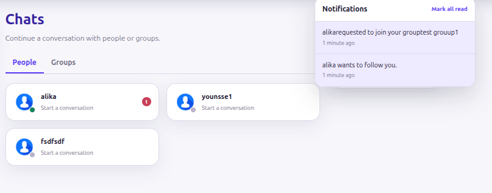<br/>**Notifications** |

---

## Tech stack

**Backend (`client_app/`)**
- Go 1.27 — module `social`
- Standard library `net/http` + `ServeMux` routing
- SQLite3 (`mattn/go-sqlite3`, CGO) with `golang-migrate` SQL migrations
- `gorilla/websocket` for the real-time hub
- `golang.org/x/crypto` (bcrypt) for password hashing, `gofrs/uuid` for session IDs
- CORS middleware, cookie-session auth middleware and a per-route rate limiter
- Image upload pipeline (JPEG / PNG / GIF, 20 MB max) served from `/socialup/...`

**Frontend (`client_web/`)**
- Next.js 16 (App Router, `output: "standalone"`), React 19, TypeScript config
- Tailwind CSS 4 + CSS Modules
- Client providers for auth session, realtime socket, unread counts, notifications and toasts
- Thin `lib/*` API layer (`api.js`, `auth.js`, `posts.js`, `profile.js`, `groups.js`, `chat.js`, `notifications.js`, `emojis.js`, `time.js`)

**Infrastructure**
- Docker multi-stage builds for both apps, `docker-compose.yml` to run them together
- `make` wrappers for every common task

---

## Architecture

```
Browser (localhost:3000)
   │  fetch() / WebSocket
   ▼
Next.js client  ──NEXT_PUBLIC_API_URL──►  Go API (localhost:8081)
   client_web/                              client_app/
      │                                        │
      │  App Router pages + providers          │  routers → middleware → handlers
      │  lib/api.js (single fetch wrapper)     │  services → repositories
      │                                        │  SQLite (client_app/Db/SocialnetDb.db)
      │                                        │  uploads  (client_app/static/socialup/*)
      └────────────────────────────────────────┘  served back at /socialup/...
```

Backend layering (clean architecture):

```
internal/
├── routers/       route table + rate-limiter / auth wrappers
├── middleware/    CORS, session auth, rate limiting
├── handlers/      HTTP + WebSocket entry points
├── services/      business rules (auth, comments, users)
├── repositories/  SQL queries (posts, follow, groups, events, messages, …)
├── models/        shared structs
├── requests/      request parsing / validation
├── utils/         hashing, images, rate limiter, helpers
└── websocket/     connection hub
```

---

## Features

**Authentication & accounts**
- Register / login / logout with bcrypt hashing and UUID session cookies
- `RequireAuth`-style middleware, persistent login state on the client
- Profile editing: avatar upload, nickname, about-me, public/private toggle

**Follow graph**
- Follow / unfollow, public profiles auto-accept, private profiles require a pending request
- Followers / following lists and counters, "Connect with people" network suggestions
- Notifications for follow requests and responses

**Posts & comments**
- Create posts with an optional image (JPEG/PNG/GIF, validated, 20 MB cap)
- Three visibility levels: `public`, `almost_private` (followers only) and
  `private` (an explicit allow-list of followers)
- Likes / dislikes and threaded comments with their own images
- Single-post discussion page

**Groups & events**
- Create / discover / join groups (join requests approved by the creator)
- Member invitations, member-only group posts and comments
- Events with **Going / Not Going** voting, notifications on new events

**Real-time**
- WebSocket hub mapping user → connection
- Private chat (allowed between users who follow each other) with emoji support
- Group chat rooms
- Live unread badges and a notification center (separate from chat)

**Notifications**
- Follow requests, group invitations, group join requests, new events, new messages
- Notification bell visible in the shell, with read/unread endpoints

**Media**
- Static upload server for avatars, post images and comment images under `/socialup/`

---

## Project structure

```
.
├── assets/                  screenshots used in this README
├── makefile                 dev/ops commands (see `make help`)
├── docker-compose.yml       backend + frontend stack
├── todo                     project roadmap / checklist
├── client_app/              Go API
│   ├── main.go
│   ├── config.json          port, db path, allowed web origin
│   ├── Dockerfile
│   ├── internal/            app, config, database, handlers, middleware,
│   │                        models, repositories, requests, routers,
│   │                        services, utils, websocket
│   ├── sqlinteraction/
│   │   └── migrations/      000001…0000010 (users → notifications)
│   ├── static/socialup/     uploaded avatars, posts, comments
│   └── Db/                  SQLite database file
└── client_web/              Next.js app
    ├── app/                 routes: /, /Signup, /Signin, /UserProfile, /followers,
    │   │                    /Newpost, /GetPost, /chat, /chatprivite,
    │   │                    /groups, /groups/[id], /gouupDetails
    │   ├── components/      ApplicationShell, NavigationSidebar, SiteHeader,
    │   │                    NetworkSuggestions, …
    │   ├── styles/          CSS modules
    │   ├── layout.jsx       global providers
    │   ├── error.jsx        error boundary
    │   └── not-found.jsx    404 page
    ├── providers/           AuthSession, RealtimeSocket, NotificationCenter,
    │                        UnreadConversation, ToastMessage
    ├── lib/                 api, auth, posts, profile, groups, chat,
    │                        notifications, emojis, time
    └── Dockerfile
```

---

## Getting started

### Prerequisites

- Docker + Docker Compose **or**
- Go 1.27+ (CGO enabled, needs `gcc`) and Node.js 22+

### Option 1 — Docker (recommended)

```bash
make up        # docker compose up -d --build
make logs      # follow both containers
make down      # stop the stack
make clean     # stop and remove the built images
```

Then open **http://localhost:3000** — the API is on **http://localhost:8081**.

### Option 2 — Native development

```bash
make install     # cd client_web && npm ci
make backend     # go run .        (API on :8081)
make frontend    # npm run dev     (web on :3000)
```

Run `make backend` and `make frontend` in two separate terminals.

### Production builds & checks

```bash
make build-backend    # CGO_ENABLED=1 go build -o main .
make build-frontend   # next build
make lint             # eslint
make help             # list all targets
```

---

## Configuration

**Backend — `client_app/config.json`**

```json
{
  "db_path": "Db/SocialnetDb.db",
  "port": "8081",
  "Host": "",
  "WebOrigin": "http://localhost:3000"
}
```

| Key | Meaning |
|---|---|
| `db_path` | SQLite file (relative to `client_app/`) |
| `port` | API listen port |
| `WebOrigin` | Allowed CORS origin — must match the web app URL |

**Frontend — build/runtime env**

| Variable | Default | Meaning |
|---|---|---|
| `NEXT_PUBLIC_API_URL` | `http://localhost:8081` | Base URL of the API, baked into the bundle at build time |
| `API_PORT` (compose) | `8081` | Host port published for the backend container |

---

## API reference

All routes are registered on the API root; cookie sessions authenticate most of them.
`auth` = behind the authentication middleware, everything else sits behind the rate limiter.

### Auth
| Method | Endpoint | Description |
|---|---|---|
| GET | `/Me` | Current session user |
| POST | `/Signup` | Register |
| POST | `/Signin` | Login (sets session cookie) |
| DELETE | `/Logout` | Logout (clears session) |

### Profile & followers
| Method | Endpoint | Description |
|---|---|---|
| GET | `/UserProfile` | Profile + activity |
| POST | `/ProfileUppdate` | Update profile / privacy |
| GET | `/followers/Pendiing` | Pending follow requests |
| POST | `/followers/Accepting` · `/followers/Declineinng` | Accept / decline |
| DELETE | `/UserUnfollow` | Unfollow |
| POST | `/Userfollowinng` | Follow a user |
| GET | `/Userfollowers` · `/UserfollowinngList` | Follow graph |
| GET | `/FetchNetwork` | People suggestions |

### Posts & comments
| Method | Endpoint | Description |
|---|---|---|
| POST | `/CreatePost` | Create post (multipart, optional image) |
| GET | `/GetPost` · `/AllPosts` | Single post / feed |
| POST | `/CreateComment` | Comment on a post |
| POST | `/Postlike` · `/Postdislike` | React to a post |

### Groups & events
| Method | Endpoint | Description |
|---|---|---|
| POST | `/CreateGroup` | Create a group |
| GET | `/DiscoverGroups` · `/JoinedGroups` · `/SeeeTheGroup` · `/GrouupMembers` | Browse / inspect |
| POST | `/CreatePostGroup` | Group wall post |
| GET | `/GetGroupPosts` | Read group posts |
| POST | `/GroupCreateEvent` · `/GroupEventParticipate` | Events & voting |
| GET | `/GroupEvents` | List group events |
| POST | `/RequesttoJoinGroup` · `/RespondtoJoinRequest` | Request to join / respond |
| GET | `/JoiningGroupRequests` | Pending join requests (creator) |
| GET | `/InviteUserstogroup` | Invite people to a group |
| POST | `/InviteGroup` · `/AcceptGroupInvitation` | Invitations |

### Chat & notifications
| Method | Endpoint | Description |
|---|---|---|
| GET | `/WebSocket` | WebSocket upgrade (chat + live notifications) |
| GET | `/UsersForChat` · `/Usersmessages` | Private conversation |
| GET | `/Grouupmessages` | Group conversation |
| GET | `/golbalenothification` | Notification center feed |
| GET | `/ChatNothification` · `/GroupChatNothification` | Unread chat counters |
| POST | `/ReadchatNothification` · `/ReadGroupNothification` · `/ReadNormaalNothification` | Mark read |

### Static media
| Path | Content |
|---|---|
| `/socialup/auth/*` | Avatars |
| `/socialup/posts/*` | Post images |
| `/socialup/comment/*` | Comment images |

---

## Database

Migrations live in `client_app/sqlinteraction/migrations/` (applied in filename order by
`golang-migrate` on startup):

| Migration | Contents |
|---|---|
| `000001_init_users` | `users` (email, password, name, DOB, avatar, nickname, about-me, privacy) |
| `000002_init_sessions` | `sessions` (UUID, user, expiry) |
| `000003_init_posts` | `posts` + `post_allowed_users` (visibility allow-list) |
| `000004_init_followers` | `followers` (`pending` / `accepted`) |
| `000005_init_groups_core` | `groups`, `group_members` |
| `000006_init_comments` | `comments` |
| `000007_init_group_content` | group posts & group comments |
| `000008_init_group_events_triggers` | `group_events`, `event_votes` + triggers |
| `000009_init_messages` | private & group messages |
| `0000010_init_notifiactions` | notification center entries |

The database file is created at `client_app/Db/SocialnetDb.db` and is volume-mounted in Docker
so data survives container restarts.

---

## Roadmap / status

Tracked in [`todo`](todo):

- [x] Phase 1 — Dockerization, SQLite + migrations, backend skeleton (CORS, rate limiter)
- [x] Phase 2 — Registration / login / logout, session middleware, auth UI
- [x] Phase 3 — Profiles, privacy toggle, follow / unfollow / requests, profile page
- [x] Phase 4 — Posts, images, comments, three-level visibility filter
- [x] Phase 5 — Groups, join requests, invitations, group posts, events & voting
- [x] Real-time chat — WebSocket hub, private chat, group chat, emoji support
- [x] Phase 7 — Notification system (follow, invitation, join request, events) + bell UI
- [x] Phase 8 — Image upload, validation, storage and static serving

---

<p align="center">
  <sub>Built with Go + Next.js · Run it with <code>make up</code></sub>
</p>
